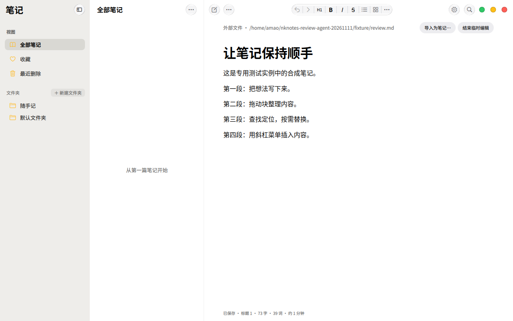
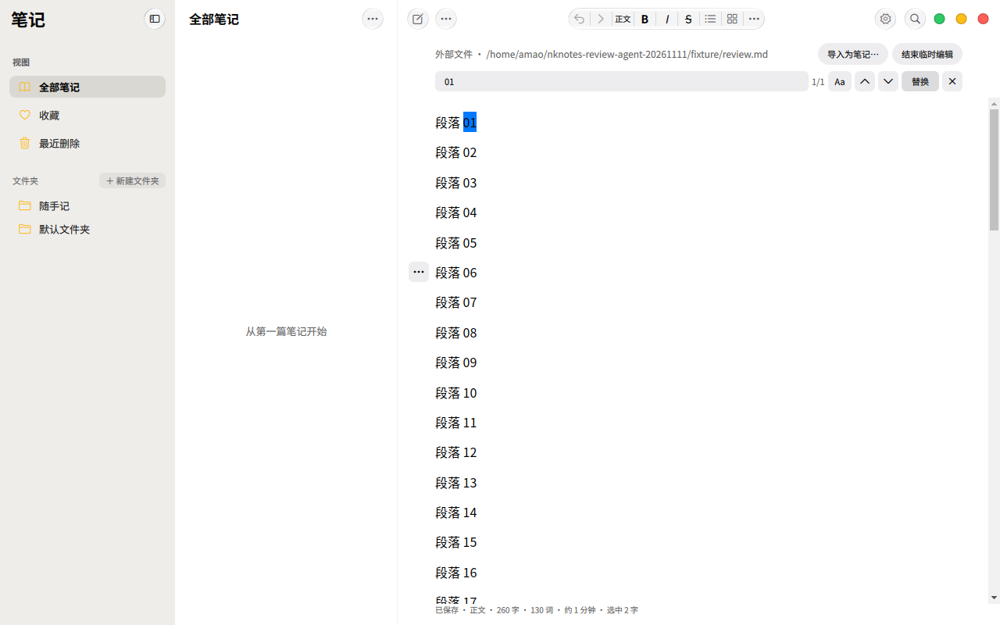
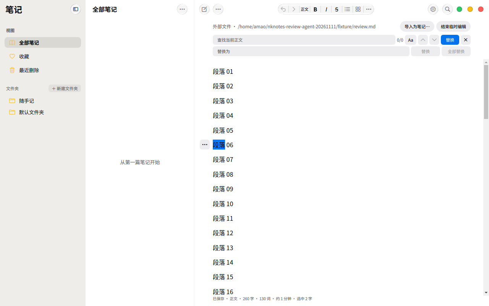
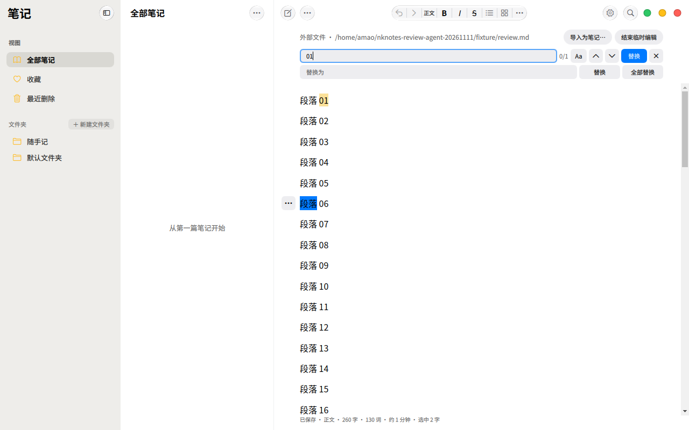
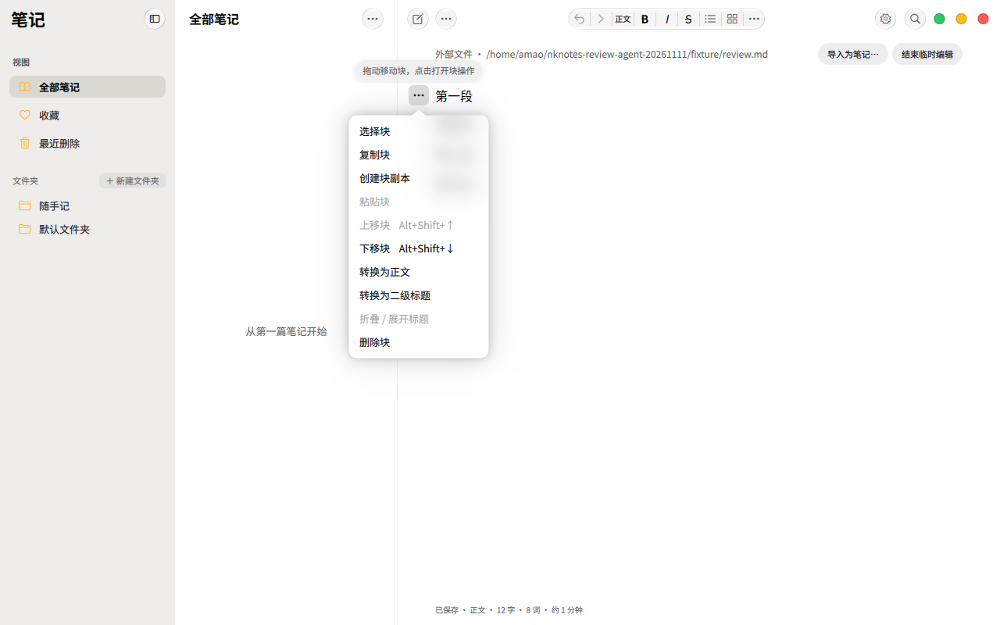
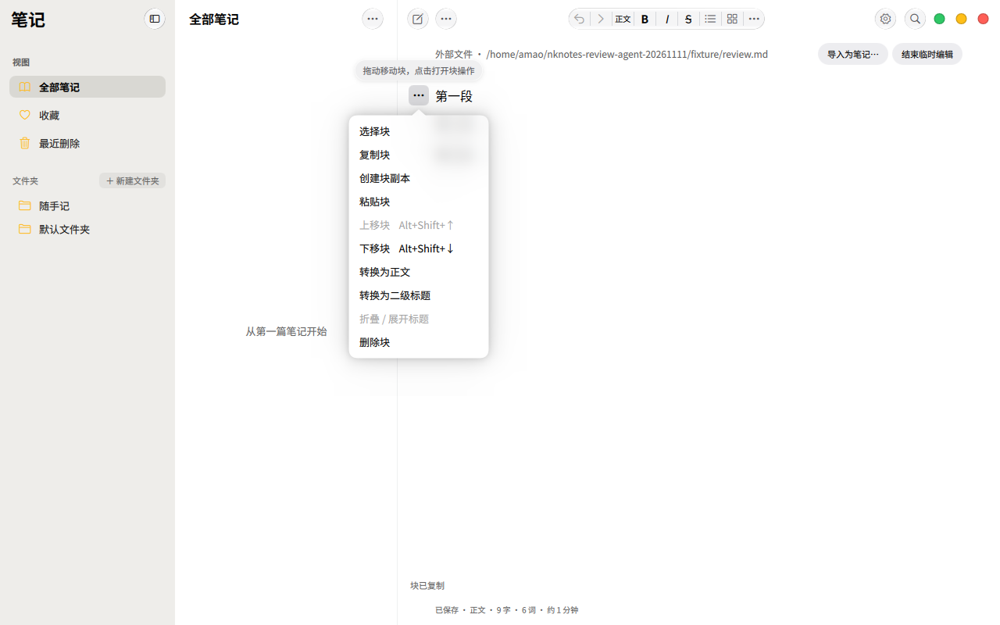
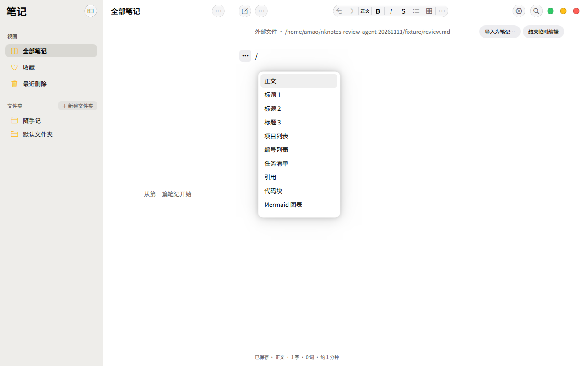

# 编辑器交互调整（2026-11-11）

目标是让正文保持安静，辅助操作在需要时可发现，并让操作反馈与实际结果一致。

## 本次调整

- 块拖动的插入线标记实际块边界，预览与松开使用同一个落点计算；折叠内容不成为不可见落点。靠近编辑区边缘停住鼠标时持续滚动，Escape、越界松开和失去编辑条件会取消拖动。
- 右键菜单按本次点击的位置确定目标，不沿用上次悬停的块。不能上移、下移、转换或粘贴时，对应操作禁用；代码、公式和图片操作按目标内容显示。
- `/` 菜单保留紧凑高度并提供完整 16 项插入入口；支持方向键访问后面的项目。取消只影响当前输入位置和查询；无匹配时保留普通编辑按键。列表内的 `/` 作为正文输入，退出列表后恢复插入菜单。
- 正文查找默认只显示一行，需要时展开替换。导航和关闭采用紧凑图标，Escape 关闭查找；重新打开或切换笔记后恢复已有查询。
- 任务框使用固定尺寸的边框与独立勾选标记，避免字体字符导致勾选前后尺寸、位置变化。

## 效果图

以下均为 VM 中实际应用窗口的截图，笔记内容为合成数据。

正文查找默认一行；替换入口在需要时展开。输入 `01` 并点击下一个匹配后，计数为 `1/1`，正文选中对应文字。

展开替换后增加一行，正文区域随之下移；空查询时替换按钮禁用。

输入 `01` 后，正文中的单处匹配高亮，匹配导航与替换动作启用。

块菜单中，首块的“上移块”和尚无块剪贴板内容时的“粘贴块”禁用；普通段落不提供代码语言等专用操作。

复制后重开菜单，“粘贴块”随之启用。

## 验证

构建、测试、原生交互和截图均限定在 `kos-vm-dev`；使用独立设置和可丢弃的合成笔记。

网页 bundle 已在 VM 重新构建并回传，SHA-256 为 `b76af6b3adb816ccd930cdeb78b50c2b0015cb6c09e7878d07d1410b2a0af3a1`。块手柄状态回归和六项真实编辑器集成检查已通过，覆盖右键目标、落点预览与撤销、折叠落点、16 项斜杠菜单键盘访问、取消状态与无结果查询。集成检查中的拖动通过工具动作验证；原始输出、失败记录及 VM 源码指纹见[验证记录](../output/editor-interaction-2026-11-11/README.md)。

原生操作已确认：第四段拖到第二段之前、再连续拖回末尾，移动后手柄仍跟随原块；在编辑区外松手不改变内容。长文底部保持鼠标不动时，滚动位置连续从 `176` 增至 `432`、`624`。Escape 独立取消检查通过，但连续移动后再次拖动的取消出现失败，因此不计为全场景通过；最终源码让拖动手柄取得键盘焦点并直接处理 Escape，保持取消后松手不提交的门控，此修复待运行复验。

原生查找已完成打开、输入 `01`、导航到 `1/1` 和展开／收起替换，截图均经查看。复制块后立即重开同一手柄菜单，“粘贴块”启用。

斜杠菜单的编辑器状态可以选到第 16 项 `toc`，但 VM 的原生弹层仍停留在顶部并高亮“正文”。最终源码改为在打开菜单、条目增删完成后同步最新选择，并将该行滚入视野；该修复已完成源码复核，尚未运行。下图记录的是修复前失败，不能作为末项可见的通过证据。

Advanced 原始回归因测试断言将整个文档的 `/\n` 与当前段落的 `/` 比较而失败；断言已修正。VM 临时副本增加 CDP 请求超时后顺序重跑，前九组通过，包括三种列表、任务框几何、块操作撤销、折叠／目录、查找替换、公式、脚注及 Mermaid。随后剪贴板图片导入等待超时，未执行后续表格宽度和最终元数据／schema 检查，因此完整套件未通过。原始失败、最终重跑输出及使用的临时驱动均保留。

最新 `Main.qml`、`SourceEditor.qml` 的跨文档查询恢复，以及 `EditorTools.qml` 的连续拖动 Escape 与斜杠菜单同步修复，均已完成源码复核。自动审批阻止向 VM 传入最新源码，因此这些修复没有运行验收。`source-hashes.json` 记录的是实际运行快照，不能当作最终提交的完整指纹。

PR 的三次 [Flatpak CI](https://github.com/NextKde/NkNotes/actions/runs/43035039939) 因 Ubuntu 软件源 DNS 解析失败，在依赖准备阶段满 60 分钟超时，未进入应用编译；日志和关联运行已保存在验证记录中。PR 暂不合入 `main`，待上述原生修复复验及最终源码构建完成。
